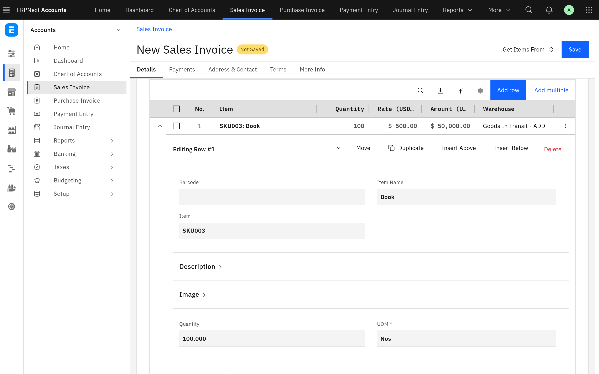

Frappe and ERPNext have their own look, and it does not match the Carbon Design System that many organisations already use. Carbon Theme for Frappe restyles the desk, the website, the login page and e-mail as if they had been designed with IBM's [Carbon Design System](https://carbondesignsystem.com) (v11): IBM Plex type, square corners, Carbon's colour tokens and focus rings, the Carbon UI Shell header and Carbon's chart palettes. The values come from the official `@carbon/*` npm packages, and the theme replaces Frappe's own stylesheets rather than adding a layer on top of them.

It is for teams that work in the Frappe desk all day and want a denser, more consistent interface, and for organisations that already use Carbon. It runs on Frappe v16 (16.50 or later) and is free software under the [MIT licence](../license.txt).

## What you get

### Every surface in Carbon

The desk, the website and portal pages, the login page, e-mail, charts and the frappe-ui apps (CRM, Helpdesk, Builder, Wiki and others) all use Carbon's tokens. Light mode uses Carbon's g10 theme and dark mode its g100 theme, following the theme each user picks in the desk. Numbers and dates in tables are set in IBM Plex Mono, and charts use Carbon's categorical palettes. See [How it works](development/architecture.md).

### The Carbon UI Shell header

A Carbon header across the top of the desk shows the current module's links and sub-menus, search, notifications, your account menu and an app switcher. It is built from Frappe's own module sidebar, so it always shows what the sidebar shows. See [Use the header](ui-shell.md).

### One table engine for every table

Child tables, the List view and the Report and Query views are drawn by one Carbon data table. Columns can be resized, reordered and sorted, child-table rows open into their form in place, and the Report view supports spreadsheet-style selection, copy and paste. See [Work with tables](tables.md).

### Brand colours and a development marker

A System Manager can set brand colours for light and dark mode and a header colour in **Carbon Settings**. On local development sites the header turns yellow with hazard stripes, so a development tab is not mistaken for production. See [Configuration](configuration.md).

### An AI assistant panel

When Frappe's [flow](https://github.com/frappe/flow_client) app is installed, the header gets an AI assistant built from Carbon AI Chat, with conversation history, feedback and file attachments. See [Use the AI assistant](ai-assistant.md).

## Where to start

| You are                                 | Read                                                                                                                             |
| --------------------------------------- | -------------------------------------------------------------------------------------------------------------------------------- |
| Someone who works in the desk           | [Use the header](ui-shell.md), [Work with tables](tables.md) and [Use the AI assistant](ai-assistant.md)                         |
| The administrator setting it up         | [Install and upgrade](install.md), [Configuration](configuration.md) and [Limitations and troubleshooting](troubleshooting.md)   |
| A developer changing the app            | [Development](development/README.md) and [How it works](development/architecture.md)                                             |
| A developer whose app or report uses it | [How it works](development/architecture.md), especially what the table engine keeps compatible and how frappe-ui apps are themed |

## Requirements

- A bench with Frappe v16, 16.50 or later. The app declares `frappe >=16.0.0,<17.0.0`, but its stylesheets import files that only exist from Frappe 16.50.
- A bench of its own. The theme replaces Frappe's stylesheets for the whole bench, including sites that do not have the app installed: see [Limitations](troubleshooting.md#limitations).
- Node and yarn on the machine that builds the assets, as for any Frappe app with a `package.json`.
- ERPNext is not required. The app works with any Frappe apps and is tested with ERPNext and HRMS.
- For the AI assistant only: the [flow](https://github.com/frappe/flow_client) app on the same site.

## Source and changes

The source is at [github.com/Avunu/carbon_theme](https://github.com/Avunu/carbon_theme). Each release is listed on the [releases page](https://github.com/Avunu/carbon_theme/releases), and the [changelog](../CHANGELOG.md) lists the changes in each version.

IBM Plex is included under the SIL Open Font License.
